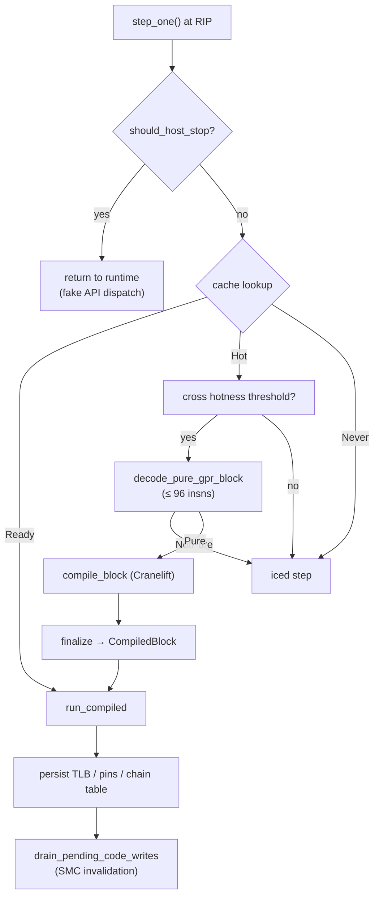
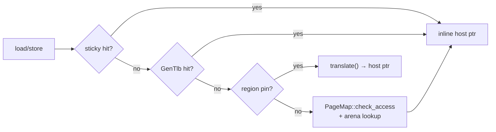

# The CPU backends and guest memory (`wie-cpu`)

`wie-cpu` is the execution engine. Two backends implement one `CpuEngine` trait: `JitCpu` (a Cranelift block JIT — the default) and `IcedCpu` (a pure iced-x86 interpreter — the `WIE_CPU=iced` oracle). Both execute against the same `GuestMemory`, which is the only memory model in the project.

## Two backends, one trait

```mermaid
flowchart TD
    subgraph CpuEngine trait
        M["mem_map / mem_read / mem_write / host_span"]
        R["run_until_stop(rip, budget, fake-va window)"]
        W["return_from_win64_api(rax)"]
        T["snapshot/restore_thread_context"]
    end

    JitCpu --> CpuEngine trait
    IcedCpu --> CpuEngine trait
    JitCpu --> J["Cranelift block JIT<br/>compile hot blocks → ARM64"]
    IcedCpu --> I["iced-x86 step interpreter"]
    JitCpu --> S["Arc&lt;JitShared&gt;<br/>shared compile cache + memory"]
    J -->|"fallback"| I
    CpuEngine trait --> G["GuestMemory<br/>mmap arenas + RegionTable + PageMap + VAD"]
```

- **`JitCpu`** compiles hot, *pure* basic blocks (GPR/memory/ALU/SSE/REP-string instructions) to ARM64 and executes them natively. Anything else — cold code, complex instructions, API stops — falls back to iced stepping.
- **`IcedCpu`** decodes and executes one instruction at a time; it shares `GuestMemory` behind `Arc<RwLock<…>>` across threads. Its job is correctness: every JIT fast path has an iced counterpart to bisect against.

## The JIT

### Compile pipeline



Key design points:

- **Hotness threshold.** A block must be visited a few times before it earns compilation; self-loops and UCRT fast-API calls compile eagerly. Cold one-shot code never pays the compile tax.
- **Chaining.** Compiled blocks `call` their known successors directly (late-bound via `wie_jit_chain_lookup` when unknown). Chain depth is capped (`MAX_CHAIN_DEPTH = 48`) to protect the host stack. The old "shadow return stack" is **removed** (2026-11): it pushed on every guest `call` and ran a three-block diamond on every `ret`, but nothing consumed the result — `shadow_pop_check` returned `ret_va` unchanged and `chain_tail` looked successors up in the chain table, never in the shadow. It was pure per-call/per-ret work, so it is gone.
- **The super path.** Stack-heavy self-loops can get a block-wide guard: one prologue check, then *bare host pointer arithmetic* (region-pin slot 0) for the loop body — the biggest single speedup for pure compute.
- **Trampolines.** 1–3 instruction micro-stubs (`ret`, `xor eax,eax; ret`, `GetLastError` reading the TEB slot, …) skip Cranelift entirely.
- **SMC correctness.** Guest stores to code pages are recorded; after each block run, any `Ready` block overlapping a written page is dropped (`drain_pending_code_writes`).
- **SIMD.** SSE2 lowers to ARM64 NEON via Cranelift's ISLE rules by default (`WIE_JIT_SIMD=1`); `WIE_JIT_SIMD=0` calls scalar `wie_sse_*` Rust helpers. Tests dual-execute every SSE2 op on JIT and iced and assert identical state.
- **Pooled workers (Wave3 default).** Background compiles run on a `min(3, available_parallelism()-1)` UTILITY pool (see `JitConfig::jit_workers`); Cranelift contexts are pooled — steady zero-alloc, no `WIE_JIT_WORKERS` env required.
- **Direct register hand-off (Q8/C) — NOT built.** Chained blocks still cross the `JitCtx` spill/reload boundary; the x19–x28 residency design in ADR 0002 is unbuilt and had no lowering call sites, so its inert `WIE_JIT_DIRECT_REGS` env gate was removed 2026-09-25. See ADR 0002's implementation-status note and the Wave 3 rows in `docs/implementation-plan.md`.

## Software translation and the TLB

Guest memory is **soft-translated**: `host = arena_host_base + (guest_va - guest_base)` is computed in exactly one place (`MemPin::translate`), with `GuestVa`/`HostAddr` distinct types. The access hierarchy inside a compiled block:

1. **Sticky page** — the last-hit single guest page (2-way sticky), the common sequential case.
2. **`GenTlb`** — a 64-entry set-associative software TLB, generation-stamped.
3. **Region pins** — 8 slots ranked by size (slot 0 = stack, slot 1 = primary heap); `translate()` enforces containment before any pointer arithmetic.
4. **PageMap slow path** — the software permission oracle (`check_access`, all-or-nothing over the access span).



One `mem_gen` counter bump on any map/protect/free invalidates the whole TLB — no per-entry removal.

## Memory model

| Component | Role |
| --- | --- |
| `MmapArena` / `ArenaSet` | One contiguous `mmap` region per arena; sorted set with binary search by guest VA |
| `RegionTable` | Named guest regions (image, heap, stack, fake-API window, …) with perms |
| `PageMap` | Sparse run-length page states + packed hot-run cache — the software permission oracle |
| `VadTable` | `VirtualAlloc` bookkeeping; free-region search upward from 4 GiB |
| `generation` | Bumped on every structural mutation — invalidates TLB/pins/compiled-cache staleness |

Two protection encodings exist on purpose: `RwxPerms` (rwx bits) and `PageProtect` (Windows `PAGE_*`). They collide numerically (`PAGE_READWRITE == 4 == EXEC`), so the type split makes silent misuse a compile error.

**The 4K/16K page relationship** is why host `mprotect` is never the oracle: guests use 4 KiB pages, Darwin host pages are 16 KiB, and a mapped guest page sits inside a wider host page. Software checks (`PageMap`) are the correctness plane; `mprotect` is an optional supplement (`WIE_MPROTECT`), applied only when ranges align to host granularity.

## Invariants and gotchas

- **`unsafe` confinement**: workspace-wide `unsafe_code = deny`, except `wie-cpu/src/jit` and `mem/arena.rs` — the JIT entry helpers and mmap wrappers are the only legitimate uses.
- **`return_from_win64_api` used to clear the shadow stack** for the same reason the stack existed at all; both are gone with it.
- **`host_span(write)` denies executable spans** — JIT code pages never get a direct writable host pointer; SMC invalidation never depends on a returned slice.
- **Background-compiled blocks are validated at install** — if `mem_gen` moved or a code page was written while the worker compiled, the result is dropped.
- **`exec::step` stubs**: `Cpuid` returns 0, `Rdtsc` reads host monotonic time — honest minimal answers, documented per instruction.

## Retryable conditions versus guest faults

**The rule: a lost race is never a guest-visible fault, and a guest fault is never retried.** Both
halves are load-bearing and this campaign has now paid for each of them separately.

A **retryable condition** is one where the emulator's own bookkeeping was momentarily inconsistent
while the guest's view of memory was not. The canonical instance is the mapping generation: every
structural mutation (`VirtualAlloc`/`VirtualFree`/`VirtualProtect`/`mem_map_image`) bumps one
counter, and the check "did the generation move since I resolved this pointer?" cannot tell which
mutation happened. A **guest fault** is one where the guest's own access is illegal: the page is
absent, or the permission bits deny the width and direction of the access.

### Why a generation bump cannot be retried on its own

A protection change *is* a generation bump. `guest_store_observes_protection_change_jit`
(`mem::tests`) is the discriminating row: a store runs, the page is then made read-only by the guest
itself, and the next store **must** fault. A generic "generation changed, so try again" retry
re-resolves the page, finds it present, and lets the store through — turning a protection violation
into a silent write. That retry was implemented, measured, and **reverted**.

The red tests in the tree at the time were *not* its doing, and the distinction is worth keeping: 17
fault-path rows were failing because a scripted edit to the stub fault arms had deleted `set_fault`,
so the stubs logged a refusal and then returned as if the access had succeeded. Toggling each edit
separately proved it — stub reverted, the rows pass; stub restored, 17 fail; `set_fault` put back,
534/534. The retry was reverted on its own merits (a protection change is a generation bump), and the
swallowed fault was an independent defect in the same window. Two defects, one count, and the count
did not say which.

So the only admissible shape is narrower than a retry on the generation:

1. re-resolve the page;
2. if the generation is unchanged, the answer is already exact;
3. if it changed, **re-check the access against the current protection** — if the current protection
   *permits* the access and the page is still present, the refusal was a race and the access may
   proceed; if it denies or the page is gone, that is a guest fault and must be reported as one;
4. a bounded attempt count, and on exhaustion report the fault, never a silent success.

Rule 3 is the whole content: a generation bump is only retryable when the *post-bump permission
state still permits the access*. Without that check there is no distinction to make.

### The test shape that discriminates them

A retry can only be trusted if both rows exist and both are mutation-tested:

* **The race row.** The same access, retried across a bump that leaves the page present and
  permitting, must **succeed**; delete the retry and this row must fail.
* **The fault row.** The same access after a protection change that now **denies** it must **fault**,
  with the right address, size and direction; widen the retry to "any generation change" and this
  row must fail. `guest_store_observes_protection_change_jit` already pins this for the store case;
  a load/no-read row belongs beside it.
* **The real-fault rows stay untouched** either way: unmapped, and present-but-denied, must fault on
  the first attempt with no retry — assert the attempt count, not just the error, because a retry
  that happens to fail again looks identical from outside.

### Two confirmed instances, and one counter-instance

Recorded with what was actually measured, at the standard this campaign now holds:

* **Decode fetch (fixed, mechanism confirmed).** `decode_at` collapsed *every* `fetch_into` error
  into "no decode", and `exec::step` then reported `invalid instruction at …` on bytes that were
  valid and merely unreadable for an instant. Split into `Decoded | InvalidEncoding | FetchFailed`;
  a `generation changed` fetch is retried (bounded, `WIE_DECODE_RETRY=0` to disable) and only a
  decoded-and-rejected encoding now reads as a bad instruction. Confirmed from a run:
  `[decode] rip=0x1400012be mgen=60 attempts=1 fetch-failed: instruction fetch generation changed at
  0x1400012be (concurrent map/free)` followed by `n=15 mgen=66 attempts=2 reason=retried-after: …`,
  twice in one 60-run arm. The field fault it was aimed at (`0x140001481`) did not reproduce in 120
  runs, so that one remains **unattributed**; the conflation fix stands on its own.
* **Data access (attributed, not confirmed).** `mem_read`/`mem_write` refuse an access whose
  generation moved mid-validation, and every caller turns that into a guest `0xc0000005`. Four
  spurious-looking violations were attributed to this (`addr=0x1000a0fff exc=0xc0000005 size=1
  rip=0x14000138d` on the fixture's own 4096-byte allocation — in-bounds by construction, from
  `mt_contention.c:395`). **60 runs with the retry disabled produced zero `[mem]` events**, so the
  attribution is code-shape, not measurement. The instrument that can settle it is the `[stub]` line
  in `lower/mem.rs`, which prints the verbatim `GuestMemory` refusal from the JIT load/store slow
  path under `WIE_MT_DEBUG=1`.
* **Counter-instance (guard added, mutation-proven).** The truncated-fetch guard: a decode from a
  buffer that was short because the *mapping* ended is a whole instruction, but a decode from a
  buffer that was short while more bytes were readable is a **prefix**, and a decoder handed a prefix
  returns some other instruction — silent execution of bytes the guest never wrote.
  `exec::cache::shortfall_unexplained` refuses the second case; forcing it to `false` makes
  `a_truncated_fetch_with_more_bytes_readable_is_not_decoded` fail.

### The third category: `unmapped` on a page that is committed and stays committed

There are three outcomes for an access, not two, and the middle one is the worst:

| outcome | meaning | correct handling |
|---|---|---|
| generation moved, page present and permitting | emulator bookkeeping raced; guest's view unchanged | retry (after the protection re-check above) |
| page absent or denied | the guest's access is illegal | **guest fault**, no retry |
| **`unmapped` for a page that is committed and stays committed** | **the emulator lost a page the guest owns** | **a bookkeeping-visibility bug — neither retry nor fault** |

The third is not a delivery decision at all: no retry policy can make a lost page appear, and
reporting it as a fault is a lie the guest will act on. A real program that reads its own committed
memory and is told it is unmapped corrupts data while nothing crashes, which is why this category
outranks every optimisation in this file.

The `[stub]` line has caught one instance. `micro-exes/mt_contention.exe`, 300 runs,
`WIE_MT_DEBUG=1`:

```
[stub] read addr=0x10008b000 size=1 rip=0x1400013e0 access=0 fault: mem_read unmapped 0x10008b000
```

`rip=0x1400013e0` is `movzbl (%rax), %ecx` with `addq $0x100, %rax` — `phase_readers`
(`main.c:365`), reading `g_shared_read`, which is `VirtualAlloc`'d once at startup (`main.c:534`,
256 KiB) and has **no free site anywhere in the fixture** (the only `VirtualFree` is `main.c:396`,
inside `va_churn`, on that thread's own 4 KiB region). The page is committed for the process
lifetime, and the read must succeed. The fixture contains no `__try`, so a delivered `0xc0000005`
there is unconditionally a dead thread — which is what the four fatal deaths were, at the same rip
family.

The one mutation in flight is a peer thread's `VirtualFree(p, 0, MEM_RELEASE)` of *its own* region,
while the JIT's stub reads guest memory through a raw pointer with no lock. The mechanism is now
identified: `PageMap::runs` was a bare `BTreeMap` walked through `&self` by the reader while the
churn thread mutated it through `&mut self` inside `VirtualFree`'s `set_range`. That is aliasing UB,
and it is not merely incoherent — the tear is observable as an incoherent run entry, which in
release is reported as `unmapped` on a live page.

The instrument is `jit/lower/mem_fault_race_tests.rs`: a time-bounded (2 s per phase) harness whose
writer thread churns one region with `VirtualAlloc`/`VirtualFree` under the guest-memory write lock
while the reader walks a *different*, never-freed region through a raw `*const GuestMemory`. Against
the unlocked map it panicked at `pagemap.rs:202`, and the panic is the whole diagnosis:

```
thread '…a_peer_free_of_another_region_never_makes_a_stable_page_unmapped' panicked at
crates/wie-cpu/src/mem/pagemap.rs:202:13:
assertion `left == right` failed
  left: 131072
 right: 131072
```

Read that twice: the assertion fires with both sides **equal**. `start` was captured from the range
iteration and `run.start_page` was read afterwards; the writer replaced the entry between the two
loads, and by the time `Debug` formatted them the tree was whole again. Only a torn read can fail an
equality between two values it prints as equal.

`PageMap::runs` is now `RwLock<BTreeMap<u64, PageRun>>` (guard taken inside the structure, dropped at
every accessor's return, no guard escapes the module; the emitted TLB fast path never reaches it
because a cache hit returns before the guard). Acceptance, measured on this host:

* `losses=0` over the 2 s budget, while the duplicate-writer control stays non-zero
  (`refusals=3084 … 14271` across runs) — the sensor is alive;
* `alloc_failures=0`;
* `debug_assert_eq!` at `pagemap.rs:202` no longer fires in a debug build, and it stays for the
  single-threaded logic bug it can still catch (key disagreeing with `start_page`);
* whole `wie-cpu` suite green in dev and release.

**Why the existing suite never saw this:** nothing in it mutates the page map from one thread while
another walks it. The harness is the first thing that does, which is why the defect surfaced as
`debug_assert` text at line 202 rather than as a failing test. Uncontended, the guard costs 5.3 ns
per acquire (20 M acquires, shape-matched `RwLock<BTreeMap<…>>` standalone bench, `rustc -O`, this
host) and the guarded walk 16.5 ns; the guard's effect on a real guest under contention is
**unmeasured**, because this host's frame timings are load-sensitive and no quiet window exists.

### Two process rules this cost us

* **After any scripted multi-site edit in a fault path, read the resulting hunk with `sed` before
  compiling.** A regex written to wrap the two stub fault arms matched through `set_fault(…)` and
  deleted it, so every stub fault became a silent success and 17 fault-path tests went red. The
  count was the only thing that showed it.
* **Never say "my edit is not implicated" without a toggle.** Revert your edit, run the failing
  rows, restore, run them again. Measured attribution beats a plausible one, and both directions of
  a toggle are cheap compared with a night of the wrong theory.
